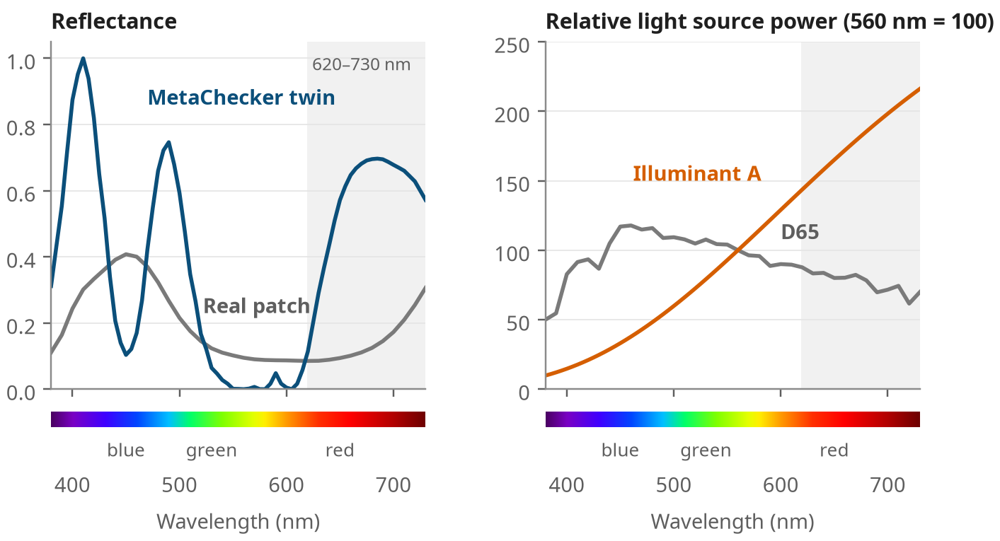
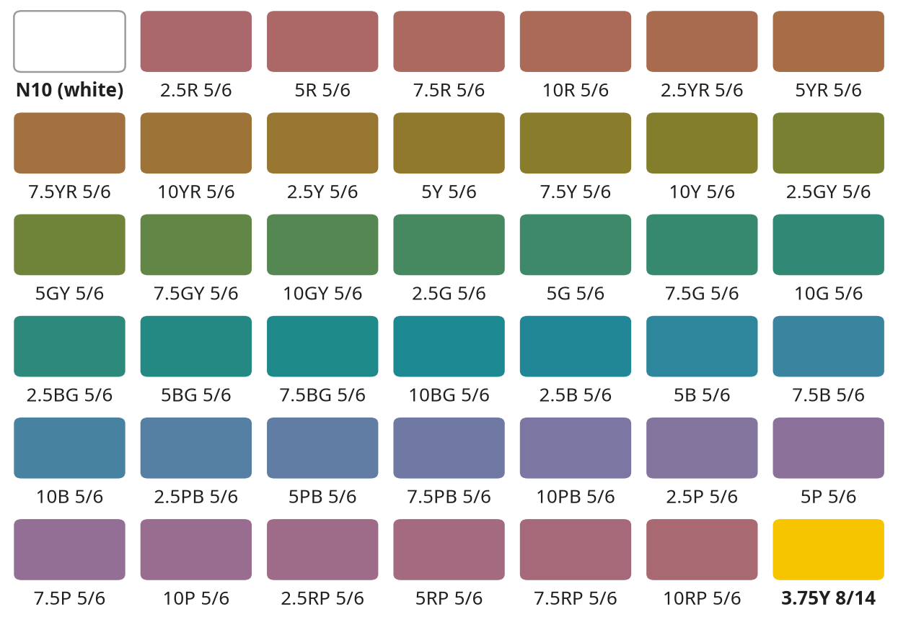
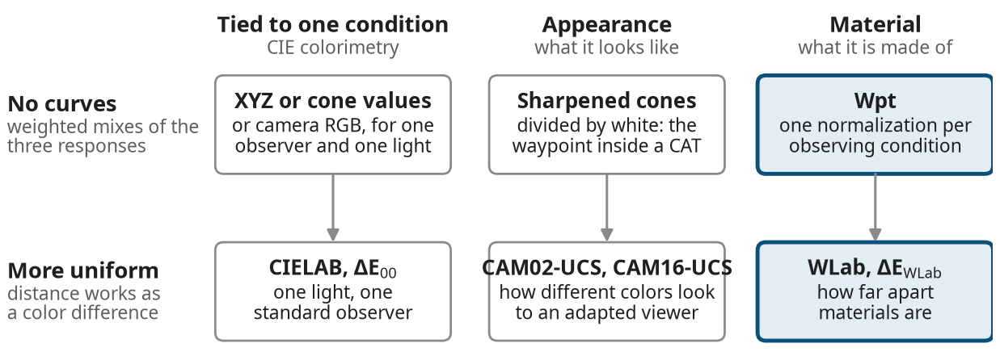
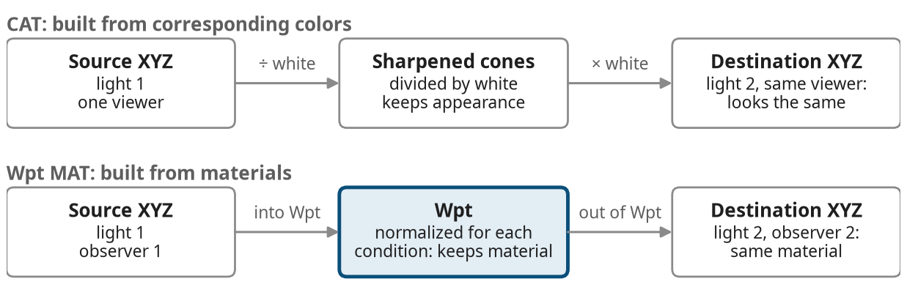
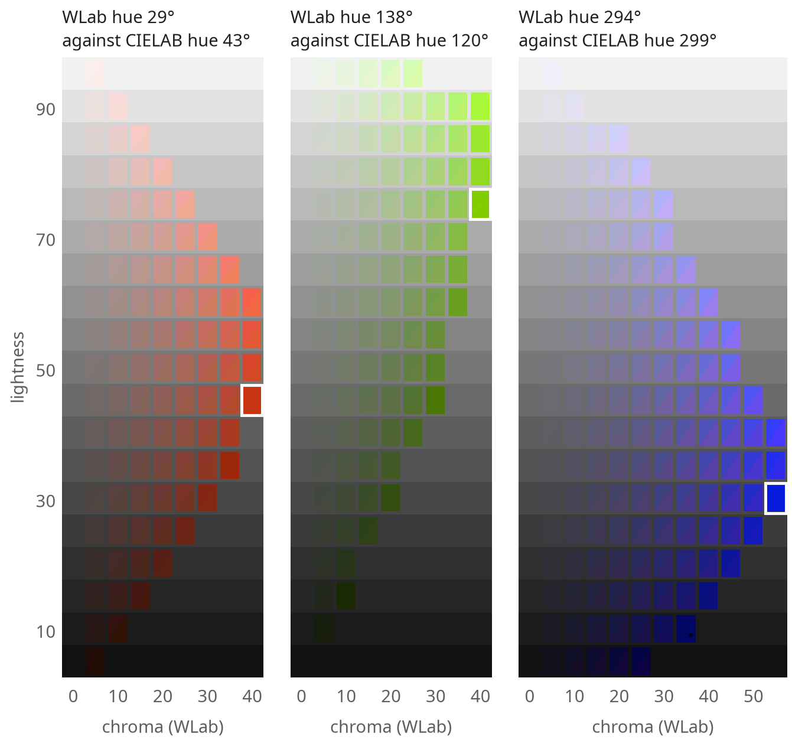

# WLab and Wpt: Color Without the Fine Print

### An Onramp to Material Color Equivalency

Maxim W. Derhak (PhD) — October 22, 2026

## Why this guide exists

This guide is an onramp to a different way of describing color: by the *material* (a paint, an ink, a fabric, a plastic) rather than by how it measures under one light for one viewer. It ends at two coordinate systems: Wpt (pronounced "Waypoint"), which describes the material, and WLab (Waypoint Lab), which reshapes Wpt so that distances read like familiar ΔE color differences. Both are introduced properly once the groundwork is in place.

Most people who work with color are at least familiar with the CIELAB color coordinate system and the ΔE color difference score. Both are good tools. But they answer a narrower question than most people think. This guide shows what that question is and what Wpt and WLab add.

No math is needed to follow the ideas. The few formulas are optional, and each one comes with a plain-words version.

For readers who want the full method, every equation and constant is written out in the Technical annex.

**Pick your path**

- New to color numbers: read straight through.
- Comfortable with CIELAB and ΔE: skim "What you may already know", then read on from "The three ingredients of every color".
- Buying or managing color: read "A material does not have one CIELAB value", then "For buyers and managers".
- Want to use it now: read "When to reach for Wpt and WLab", then "Getting started".

## The short version

- A CIELAB value describes a sample under one light, as one standard viewer sees it. Change the light or the viewer and the value changes, by a different amount for each sample.
- That is why two samples that match in the viewing booth can stop matching in the store. The name for it is metamerism.
- Wpt and WLab are coordinates for the material itself: for typical materials they stay nearly the same whatever the light and whoever is looking, and how far a material does move is useful information in itself. WLab differences are designed to be similar in size to familiar ΔE values.
- With them you can ask questions a booth reading cannot answer. Will this match hold under store lighting? Does this ink hold its color? Do these two viewers, or a camera and a person, agree?
- A material adjustment transform (MAT) carries measurements from one light and/or viewer to another by way of the material.
- Keep CIELAB and ΔE00 for work under one light and for contracts. Reach for WLab when a comparison crosses lights, viewers or devices.

The rest of this guide explains each of these, with a worked example.

## What you may already know: CIELAB and ΔE

A CIELAB value is the color of a sample as one standard viewer sees it under one named light. Everything else in this guide builds on that one sentence.

CIELAB (often just called Lab) gives each color three numbers:

- **L\*** is lightness, from 0 (black) to 100 (white).
- **a\*** runs from green (negative) to red (positive).
- **b\*** runs from blue (negative) to yellow (positive).

The same color can also be given in polar form: its **chroma** C\*ab, how far it sits from gray (how colorful it is), and its **hue angle** hab, the direction around the gray axis in degrees (0° toward red, 90° toward yellow).

**ΔE** is how far apart two colors sit in that space. ΔE\*ab is the plain straight-line distance. CIEDE2000 (ΔE00) adds corrections for regions where the straight line gets it wrong, such as blues and near-neutrals. As a rough guide, a ΔE00 near 1 is a difference a trained eye can just see side by side.

**Lights and illuminants.** Color calculations often do not use a real light source. Instead, they use an *illuminant*: a written specification of an idealized light, giving how much power it has at each wavelength. The CIE publishes the common ones. D50 and D65 stand for daylight (D50 is used in printing, D65 in most other work), and illuminant A stands for an incandescent bulb, the traditional kind with a tungsten filament.

**How a CIELAB value is made**

1. Measure the sample's spectral reflectance: how much light it reflects at each wavelength.
2. Choose an observer (the CIE 2° or 10° standard observer) and an illuminant (often D50 or D65).
3. Combine the three to get tristimulus values, X, Y and Z.
4. Divide by the X, Y and Z of white under the same light.
5. Compress the result with a cube-root curve and apply some math to get L\*, a\* and b\*.

**The assumptions behind it**

- **The light is fixed.** A value marked "D50, 2°" holds for D50 only. Under an incandescent bulb the sample has a different CIELAB value.
- **The viewer is an average.** The standard observers are averages from color-matching experiments run in the 1920s to 1950s. No real person matches them exactly, and no camera does.
- **Dividing by white only lines up the neutrals.** Step 4 makes white and grays agree from one light to the next. It does not do the same for reds, greens or blues.

These three assumptions are the fine print on every CIELAB value. None of them is a flaw when you stay in one condition; they matter as soon as you compare across lights or viewers, which real work keeps doing.

## The three ingredients of every color

Every color measurement combines three things: a light, a material and an observer. Change any one of them and the numbers change.

- **The light** has a spectrum: how much power it gives at each wavelength. Daylight, incandescent, fluorescent and LED lights all have different spectra. An illuminant, such as D65 or A, is a standard written-down version of one kind of light.
- **The material** has a spectral reflectance: the fraction of light it sends back at each wavelength. This belongs to the object. It is the part people usually mean by "the color of the paint".
- **The observer** has three sensitivity curves. For a person these are the sensitivities of the three cone types (cone fundamentals), or the color-matching functions of a standard observer: three curves, a re-mix of the cone curves, that give X, Y and Z. For a camera they are its red, green and blue sensor curves.

Let's think of the combination of the observer and the light together as an **observing condition**. That is broader than the usual "viewing condition", which tends to mean only the light.

Each of the observer's three responses is built up wavelength by wavelength: how much light the source gives, times how much the material reflects, times how sensitive that sensor is, all added together.

**An analogy.** Think of the material as a song, the light as the room it is played in and the observer as the listener's ears. A CIELAB value is a recording of what one standard listener heard in one room. The rest of this guide is about writing down the song itself, as far as three numbers can.

## A material does not have one CIELAB value

Many people believe a swatch *is* its CIELAB value. It is not. A CIELAB value describes one swatch under one light for one observer, and changing the light or the observer changes it, by a different amount for each swatch.

Three everyday effects come out of this:

- **Metamerism.** Two materials with different spectra match under one light and not under another. Two gray fabrics match in the store and look different outdoors.
- **Observer metamerism.** Two people, or a person and a camera, disagree about whether two samples match. Displays with narrow-band primaries are known for this.
- **Color inconstancy.** One material's color shifts, relative to typical materials around it, when the light or the observer changes.

**A worked example.** Take one patch of the X-Rite ColorChecker, Purplish Blue, and its twin from the MetaChecker, a research set of computed spectra made to match each ColorChecker patch. The twin has a deliberately jagged spectrum that matches the real patch exactly for the CIE 1931 (2°) standard observer under D65. View both under D65, a CIE standard daylight, then under illuminant A, the CIE's standard incandescent light.

*Figure 1. Purplish Blue: the real ColorChecker patch and its MetaChecker twin (left), and the CIE illuminants D65 and A (right). The two match exactly for the CIE 1931 observer under D65; the twin reflects strongly where illuminant A is strong, so under A it turns redder. Shown 380–730 nm; the calculations use 380–780 nm.*

The two spectra look nothing alike, yet under D65 they give exactly the same numbers. The twin reflects a lot of red light, and illuminant A is rich in red light, so under A the twin turns redder than the real patch.

| Purplish Blue | Real ColorChecker patch (smooth spectrum) | MetaChecker twin (jagged spectrum) |
| --- | --- | --- |
| CIELAB under D65 | 41.7, 14.4, −42.9 | 41.7, 14.4, −42.9 |
| CIELAB under A | 39.2, −1.9, −45.5 | 39.1, 25.1, −48.7 |
| Change from D65 to A, ΔE00 | 12.7 | 5.4 |

Under D65 the two are a perfect match. Under A they are ΔE00 17.3 apart: that is metamerism. CIELAB also says the real, smooth-spectrum patch changed more than its jagged twin. Is that true of the materials?

Not from plain CIELAB. Dividing by white (step 4 above) is a rough stand-in for the eye adapting to the light: it is exact for grays and only approximate for everything else. So a plain CIELAB change from one light to another mixes what the material does with what that rough step misses. The rest of this guide comes back to this example once the pieces are in place.

*These values were calculated for this guide with the CIE 1931 observer. They are not a visual experiment.*

## Material Color Equivalency: same stuff, not same look

There are two different ways for colors to be "the same". The two are often confused, and the coordinates in the rest of this guide are built on the second one.

Tear a sheet of paper in half. Put one half under daylight and the other under a warm incandescent bulb. Then ask two different questions:

- **Do they look the same?** Usually not quite: the incandescent half looks warmer. Asking which patch under incandescent light *looks like* the daylight half gives **corresponding colors**. That is the ground truth behind chromatic adaptation transforms (CATs) and of color appearance models such as CIECAM02 and CAM16, which predict how colors look to a viewer adapted to their surroundings.
- **Are they the same material?** Yes, and people can judge this to some degree, even when the two halves look different. Asking which patch under incandescent light is *made of the same stuff* is the idea behind experiments where people pick the **least dissimilar match**: the patch that differs least from the original when none matches exactly. Colors judged to be the same material belong to one **material color equivalency (MCE)** class.

A material match involves all three ingredients together: the material, the light and the observer. A good material coordinate should stay roughly the same whichever light the material is under and whoever is looking. (For the research behind this idea, see "The idea of material color" under Further reading.)

**A waypoint for color.** A waypoint is a fixed reference point on a route that you navigate by. A material color equivalency space can play that role between observing conditions: go from where you are into the shared space, then out to where you want to be. The next section builds such a space and names it for this idea: Wpt, pronounced "Waypoint".

Keep the two ideas side by side, not in competition. Appearance answers "what will this look like here?" Material equivalency answers "is this the same material, and how far apart are these materials?" They are complementary, and one can feed the other.

## Wpt: coordinates for the material

**Wpt normalization** turns an observer's three responses into three material coordinates, W, p and t. It is a short series of basic math steps (rotate, tilt, stretch and scale), worked out once for each observing condition. The steps are chosen so that the same materials land in nearly the same place whatever the light and observer. (Mathematically, the steps combine into one 3 × 3 matrix, but you don't need to know that to use it.)

**The three axes**

| Axis | Meaning | Direction |
| --- | --- | --- |
| W | Linear lightness (like Y) | White = 100, black = 0 |
| p | Red–green axis | Reddish toward +p, greenish toward −p |
| t | Yellow–blue axis | Yellowish toward +t, bluish toward −t |

The layout echoes CIELAB on purpose: p is like a\* and t like b\*. W is like Y rather than L\*: a 50% gray has W = 50 (WLab's Lw, below, is the counterpart of L\*). Unlike CIELAB, Wpt uses no curves: each coordinate is a weighted mix of the three responses. That is why it works the same way from XYZ, cone responses or camera RGB.

**How the normalization is built (optional reading)**

The Munsell system is a color atlas laid out in equal visual steps of hue, lightness (Value) and colorfulness (Chroma); "5R 5/6" means hue 5R, Value 5, Chroma 6. Wpt's reference is the Munsell Renotation (the 1943 respecification of the Munsell colors in CIE terms), with the CIE 1931 (2°) observer under illuminant C, an older daylight standard. Forty Munsell colors at Value 5 and Chroma 6 cover every hue at one lightness and one chroma. A perfect white and one vivid yellow (Munsell 3.75Y 8/14, close to unique yellow, the yellow that looks neither reddish nor greenish) complete the set of 42, shown in Figure 2.

*Figure 2. The 42 samples that set up Wpt: white, 40 Munsell hues at Value 5, Chroma 6, and one vivid yellow (read across each row). Colors are approximate sRGB renderings of the measured reflectances (CIE 1931 observer, D65).*

*All 40 hues share one Munsell Value (lightness) and one Chroma (colorfulness); only the hue changes. On screen they may not look equally vivid, because the swatches are approximate renderings.*

From these samples, the reference normalization is built in five steps:

1. **Line up white.** Rotate the space so white lies on the first axis, and scale it so white has W = 100. Every neutral now sits on the W axis.
2. **Level the lightness.** Tilt the space so the 40 colors of equal Munsell Value share one W.
3. **Round the chroma.** Stretch the chromatic plane so the 40 colors of equal Munsell Chroma sit as close to a circle as a simple stretch allows.
4. **Point the hues.** Turn the circle so the vivid yellow points along +t and the reds fall on +p.
5. **Set the scale.** Scale p and t so the vivid yellow is 100 from the W axis.

This gives the reference normalization. For any other observer or light, steps 1 and 2 are repeated, and a best-fit step then moves the 40 colors as close as it can to where they sit in the reference. The fit works in order: white first, then lightness, then hue and chroma. It decides what to keep exact and where the compromises go.

Practical Wpt keeps that reference and lets you choose which materials carry it to a new condition, such as the patches of a ColorChecker or a set of inks. The reference itself never moves.

**Properties worth knowing**

- **Neutrals are exact.** A spectrally flat gray has the same Wpt under every light and for every observer.
- **The form of the observer doesn't matter.** Color-matching functions, cone fundamentals or any other re-mix of the same observer's curves give identical Wpt coordinates.
- **It is invertible.** Every normalization can be run backwards, from Wpt to that condition's XYZ, cone values, or sensor values.
- **Mixing a material with gray keeps one hue.** Mix a material's reflectance with a spectrally flat gray in any proportion (as halftones and other area mixtures do; pigment tints only approximate this), and every result has exactly the same Wpt hue, under any light and for any observer. That hue can move a little from one condition to another, but within each condition the whole family shares it. CIELAB hue does not stay put in this way: for one blue family it spread by about 12.5° under incandescent light.
- **It is not perceptually uniform.** Equal steps in Wpt are not equal visual steps. That is WLab's job.

## WLab: measuring difference between materials

WLab (Waypoint Lab) reshapes Wpt so that a plain straight-line distance works as a color difference, comparable to the leading ΔE formulas. Another way to see it: every Wpt normalization predicts what the reference observer (CIE 1931, under illuminant C) would see for the same material. So a ΔEWLab is, in effect, the color difference that observer would judge between the two materials under illuminant C, wherever they were measured. The prediction is close, not exact: the reference observer may see a material slightly differently under illuminant C, and that difference is metamerism between the two observing conditions (observer and light). WLab has fine print too: a reference observer under illuminant C, and a prediction that is close but not exact. But it is the same fine print for every light and every viewer. WLab is not a color appearance space. It is to Wpt what CIELAB is to XYZ.

WLab has three coordinates, Lw, aw and bw (the w stands for WLab), read like L\*, a\* and b\*. Despite its name, WLab is not a version of CIELAB: it is built on Wpt, and "Lab" only says that its three numbers read the same way. WLab has a polar form too: lightness Lw, chroma cw and hue angle hw, and its hue angle is the Wpt hue angle, unchanged. The difference between two colors, ΔEWLab, is just the straight-line distance between them, as ΔE\*ab is in CIELAB.

**What the transform does, in words (optional reading)**

1. **Lightness.** W goes through the same cube-root curve that CIELAB uses for L\*, so Lw reads like L\*.
2. **Chroma and lightness.** Chroma is rescaled with lightness, so a given chroma means the same at light and dark levels.
3. **Chroma and hue.** Chroma is compressed on a logarithmic curve whose strength depends on hue. This is the step that makes small and large differences come out right together.

Each step can be undone, so WLab converts back to Wpt exactly. The equations take a few more lines than CIELAB's and are about as involved as CIEDE2000's. The difference is where the work happens: CIEDE2000 adds weights every time two colors are compared, while WLab puts the work into the coordinates once, so every comparison afterwards is a straight line.

**How good is it?** Tested against two datasets from color-difference assessment experiments, ΔEWLab performed about as well as ΔE94, ΔE00 and other leading formulas (the differences were not statistically significant). Against the Munsell system, its large-scale spacing is about as even as that of CIELAB and of CAM02-UCS (a uniform space built on CIECAM02). The details are in the Technical annex (A.6).

**What a WLab difference means.** Because every WLab value goes through Wpt, a ΔEWLab is a difference between *materials*, not between two appearances. Values from different lights and observers share one common representation, so you can compare materials as each condition records them, the way prices compare once they're all in the same currency. That includes custom observers, not only the CIE standard ones: the CIE 2006 observers for a given age and field size, the CIE 2015 observers, or a camera's sensor curves. Build the Wpt normalization for that observer and light, and its WLab values join the same representation. That lets us finish the Purplish Blue example.

**The example, revisited.** Here are the same two Purplish Blue patches from "A material does not have one CIELAB value", now in WLab.

| Purplish Blue | Real ColorChecker patch (smooth spectrum) | MetaChecker twin (jagged spectrum) |
| --- | --- | --- |
| WLab under D65 | 41.7, 10.3, −32.2 | 41.7, 10.3, −32.2 |
| WLab under A | 42.2, 8.0, −32.1 | 39.9, 21.1, −32.2 |
| Change from D65 to A, ΔEWLab | 2.3 | 11.0 |
| CIELAB change, for comparison, ΔE00 | 12.7 | 5.4 |
| CIELAB with a CAT (CAT02), change, ΔE00 | 0.9 | 14.1 |

WLab reverses plain CIELAB's verdict: the real patch with its smooth spectrum moves little (2.3), and the jagged twin moves a lot. Across the 18 chromatic ColorChecker patches, plain CIELAB says the real patch moved more than its twin in 5 cases; WLab, and CIELAB with a CAT, say so in none.

The last row shows that the familiar fix agrees. Adding a proper chromatic adaptation step to CIELAB (CAT02, described under "CATs and MATs") gives the same verdict for this single observer. What WLab adds is one common representation in which the same comparison also works across observers and cameras, and an adjustment built on materials rather than on how colors look. What a material moves beyond typical materials is its color inconstancy.

**One caution.** ΔEWLab does not predict what a particular person will see in a particular room. That is the job of a color appearance model. WLab tells you how far apart materials are, in units that behave like familiar ΔE units.

**Where it all fits.** Each column pairs a simple, curve-free space with its more uniform partner, the way XYZ pairs with CIELAB.

*Figure 3. Wpt and WLab fill the material column of a familiar grid.*

Read across a row to compare the kinds of question each space answers; read down a column to see the uniform space built on its curve-free base.

## CATs and MATs: two ways to bridge conditions

**Starting with the familiar one: the CAT.** A chromatic adaptation transform (CAT) predicts which numbers will *look the same* to one viewer after the light changes. Your eyes adapt: a white shirt still looks white under a warm lamp. A CAT models that adaptation. It is built from corresponding-color experiments, in which people match how colors look under two different lights. CATs such as Bradford and CAT02 are used widely in color management, and a CAT sits inside each color appearance model (CAT02 in CIECAM02, CAT16 in CAM16).

**Now the new idea: the MAT.** A material adjustment transform (MAT) asks a different question: what will this *same material* measure under a different light, for a different observer, or both? It does not model a viewer adapting. It predicts the numbers the material itself would give in the new condition, as if you had measured it there.

Think back to the torn sheet of paper. A CAT asks which patch under incandescent light *looks like* the daylight half. A MAT asks what the incandescent half of the same sheet will measure. The two answers usually differ.

**When you want a MAT.** Whenever the material is what matters:

- converting measurements made under one light to another light;
- converting a camera's, or a particular person's, responses to standard colorimetry, and back;
- comparing data gathered for different observers.

In each case there is no single adapted viewer to model, only a material and the numbers it would give. Because a MAT works through materials, it handles a change of observer as easily as a change of light. A CAT is not designed to bridge two different observers. It describes how one viewer adapts to a new light, and says nothing about how two viewers' responses relate. Even so, CATs often get used for these jobs, simply because they are the familiar tool.

**No MAT is exact.** A material's numbers in a new condition depend on its full spectrum, and three numbers do not record a spectrum. The Purplish Blue twins prove it: identical numbers under D65, different numbers under A. A MAT makes a close prediction for typical materials. What is left over is the color inconstancy that WLab measures.

**Converting the observer itself.** A MAT can be applied to more than measurements. Apply it to an observer's sensitivity curves (cone fundamentals, color-matching functions or camera sensor curves) and you get a new set of curves that responds to materials the way the destination observer does. For example:

- cone fundamentals to color-matching functions;
- the CIE 2015 observer to the CIE 1931 observer;
- a camera's sensors to a standard observer.

Material equivalency is what makes this work: the converted curves put each material where the destination observer would put it. For two forms of the same observer, such as its cone fundamentals and its color-matching functions, the conversion is exact. Between different observers it is a close fit for typical materials. Fitting a camera to a standard observer is familiar from camera calibration; what is new is doing it through materials, so custom observers, cameras and the standard observers can share one color-managed workflow.

A CAT and a MAT both work the same way: go into an intermediate space, then come out again. Even the white balance in a camera works this way: it scales the colors so the scene's white becomes a standard white, then scales them again for the white you want to show. What differs is the waypoint in the middle:

- A **CAT** goes through sharpened cone responses (cone curves made narrower so that adapting works better) divided by white, tuned to corresponding-color experiments. Its waypoint keeps *appearance*.
- A **Wpt MAT** goes through Wpt. Its waypoint keeps *material*. The whole MAT is two steps.

First, the source condition's Wpt normalization takes you into Wpt. Then the destination's normalization, run backwards, takes you out.

*Figure 4. A CAT and a MAT take the same route through different waypoints. Both map white exactly (the CAT with full adaptation); only the MAT also handles a change of observer.*

The shape of the route is the same; what the middle step is built to keep is what differs.

|  | Chromatic adaptation transform (CAT) | Material adjustment transform (MAT) |
| --- | --- | --- |
| Question | What looks the same to this viewer under the new light? | What will this material measure under the new light or observer? |
| Built from | Corresponding-color experiments | Materials (Munsell reference, or a chosen set of base reflectances) |
| Handles a change of observer | No: it models one viewer adapting | Yes: light, observer or both in one step |
| White and grays | Mapped exactly (with full adaptation) | Mapped exactly |
| Typical use | Appearance, color appearance models | Converting measurements, custom observers, comparing conditions |

**Does it work?** Over 5,162 real reflectances (flowers, ColorChecker charts, Munsell, natural objects, paper, lumber, IT8 targets; the set includes Munsell samples of the kind Wpt is built from), the Wpt MAT predicted D65 colorimetry from other conditions more closely than CAT02 or Oleari's published MATs did (the Wpt paper, Further reading 2). For the 10° observer the mean ΔE00 from illuminant A was 1.24 for the Wpt MAT against 2.35 for CAT02. The companion package runs a smaller version of this test (1,600 Munsell colors, CIE 1931 observer, A to D65): 1.09 for the Wpt MAT against 2.26 for CAT02. As you would expect, on the corresponding-color data in the same paper CAT02 predicts how colors look better than the MAT does. Each is best at its own job.

The two also chain together: a MAT can bring measurements to a standard condition, and a CAT or color appearance model can take over from there.

## What you can do with it

WLab values from any material, light and observer share one common representation. That turns several hard questions into the same simple move: hold some of the three ingredients fixed, vary the rest, and measure the distance in WLab.

| Question | What changes (what stays fixed) | What the WLab distance tells you |
| --- | --- | --- |
| How different are these two samples? | The material (light and observer fixed) | Color difference, as with ΔE |
| Does this sample hold its color? | Light, observer or both (one material) | Color inconstancy: how far the material moves from itself |
| Will this match survive? | Light, observer or both (two materials that match in one condition) | Metamerism: how far apart they drift elsewhere |
| Do these two observers agree? | The observer: a person, a standard or a camera (materials and light fixed) | Observer agreement: how alike two observers are |
| How well does this light render color? | The light (materials and observer fixed) | Illuminant color rendering against a reference light (not the same as CRI) |
| All of the above at once | Several things | Combinations, such as a camera under LED against a person in daylight |

One caution for the observer and light rows: each Wpt normalization absorbs the overall difference between its condition and the reference, so these numbers measure only what is left. A light that makes every color a little more vivid can score near zero here. The rows show how differently materials behave, not overall shifts.

**Shift manifolds.** One material under many lights and observers gives a small cloud of Wpt points, its *Wpt shift manifold*. The cloud's size shows how inconstant the material is, and its shape shows which way it drifts. Research metrics built on these clouds are listed under Further reading. Materials whose spectra have similar overall shapes tend to drift alike.

**Conversions.** A MAT is also a practical tool:

- **Between observers.** Convert colorimetry for a custom observer (one person, an age group, a camera) to and from standard colorimetry. It works the same whether the observer is given as cone fundamentals or color-matching functions.
- **Between lights.** Estimate what a measurement taken under one light would be under another when no spectral data are available.
- **In color management.** Profiles in iccMAX (ICC.2, the ICC's extended color profile format) can carry a Wpt MAT, so custom-observer workflows run in an ordinary color-managed pipeline. The ICC's open-source iccDEV tools do this.

**Another option to try: gamut mapping.** Every printer and display can reproduce only part of the full range of colors, its *gamut*. Gamut mapping moves colors that fall outside it to ones that fit, usually toward gray while trying to keep their hue. WLab can serve as the space for that mapping. Its distances work like familiar ΔE values, and its hue lines run straight out from white on the familiar horseshoe-shaped chromaticity diagram. In the author's experience, gamut mapping in Wpt gives reasonable results, but how well it works depends on the printer, the display and the images: it is an option to try and judge on your own work.

**Try it yourself.** Figure 5 is a small experiment you can run by eye, for three hues: a red, a green and a blue. Each row is one lightness, running from gray to the most vivid color that fits on screen, and each chip is split in two. The upper-left half holds WLab hue constant. The lower-right half has the same lightness and chroma but holds CIELAB hue constant, at the hue of the ringed chip. Where the halves differ, a gamut mapping that keeps CIELAB hue would shift the hue that WLab keeps. Look across the rows, especially toward the lighter and grayer chips, and judge for yourself which half stays closer to the hue of the ringed chip. The two part clearly in the red and the blue, where the CIELAB halves drift toward orange and violet; in the green they are only slightly shifted to yellow. This uneven sensitivity to hue is the same thing ΔE00's hue corrections for blue deal with. The companion package draws the same picture for any hue.

*Figure 5. Constant WLab hue against constant CIELAB hue for a red, a green and a blue. Each row is one lightness, from gray (left) to the most vivid color that fits on screen. Each chip is split: upper left, constant WLab hue; lower right, the same L\* and C\*ab at the CIELAB hue of the ringed chip, the darkest of the most vivid. CIE 1931 observer, D50 (the ICC profile connection space), shown through a Bradford adaptation to sRGB; a dot marks a CIELAB half outside sRGB. Screen and print colors are approximate.*

## When to reach for Wpt and WLab

If everything happens under one light for one standard observer, CIELAB and ΔE00 are fine; keep using them. Reach for Wpt and WLab when a comparison crosses lights, observers or devices.

| Your situation | Use |
| --- | --- |
| Checking a print against a proof in one viewing booth | CIELAB and ΔE00 |
| A specification or contract written in ΔE00 | CIELAB and ΔE00 |
| Judging whether a match will hold under store, office and home lighting | WLab: metamerism and color inconstancy |
| Comparing data measured under different lights or for different observers | Wpt and WLab: one common representation for all of it |
| Converting colorimetry between a custom observer, a camera and a standard observer | A Wpt MAT |
| Describing colors and color differences for a custom observer (an age group, a CIE 2015 observer, a camera) | Wpt and WLab built for that observer |
| Choosing between lights, or between materials, for consistent color | WLab across the candidates |
| Predicting how a scene will look to a viewer adapted to its surroundings | A color appearance model (CIECAM02 or CAM16), optionally fed by a MAT |

**What not to expect.** Wpt reduces color inconstancy; it does not remove it. A material with a jagged spectrum will still drift, and WLab will show it drifting. That is information, not error. And for one chart, a Wpt MAT is about as accurate as a simple correction fitted to that chart that keeps white exact. Its value is the one common, meaningful representation it gives you, not extra accuracy.

## For buyers and managers

You will rarely compute WLab yourself. As with ΔE today, you ask for it, read it and decide. What it adds is the question a booth ΔE cannot answer: will this match hold where the product is actually seen?

**A story.** A brand owner approves a red. Two suppliers submit matches, and both measure ΔE00 0.0 against the standard in the D50 viewing booth. Both pass. A WLab robustness report then compares each submission with the standard under the other lights the product will meet:

| Light (observer) | Submission 1 (smooth) | Submission 2 (jagged) |
| --- | --- | --- |
| D50 booth, ΔE00 | 0.0 | 0.0 |
| D50 booth, ΔEWLab | 0.0 | 0.0 |
| D65 daylight | 0.0 | 0.5 |
| A, home incandescent | 0.1 | 0.7 |
| F2, cool white fluorescent | 0.5 | 3.7 |
| F11, tri-band store fluorescent | 0.9 | 12.9 |
| D50, CIE 1964 (10°) observer | 0.1 | 0.2 |

All values are ΔEWLab against the standard, CIE 1931 observer, except where the row says otherwise. Submission 1 stays close everywhere. Submission 2 matches in the booth but drifts apart under fluorescent store lighting. If the product will sit under that kind of light, Submission 1 is the safer choice, even though both passed.

*The three spectra were made for this guide from a Munsell red included in the companion package, so the example can be rerun. Real submissions made with very different colorants can behave like Submission 2.*

**What to ask for**

- Spectral reflectance of the standard and of each submission or production sample, not just CIELAB values: ideally 380–730 nm every 10 nm, the grid the robustness workbook uses (data that start at 400 nm can be extended by repeating the 400 nm value).
- The lights that matter for the product: the viewing booth, the store lighting and home lighting. For the booth and for a particular store light, its measured spectrum: a "D50" booth only approximates D50.
- A robustness report: ΔEWLab between each sample and the standard under each of those lights, and for a second observer if viewers of different ages matter.

Sample wording for a request: *"With each submission, supply the spectral reflectance of the submission and the standard (380–730 nm at 10 nm), and a WLab robustness report against the standard under D50, illuminant A and our store lighting, CIE 1931 observer."*

If the spectra come to you, you can make the report yourself: the companion package includes a robustness workbook. Paste the spectra of the standard and up to ten samples, pick the lights from a list, and the table above appears. Your own store or home lights can be added by pasting their measured spectra. It needs no programming.

**How to read the report**

- Read each number like a ΔE: ΔEWLab values are designed to be similar in size to familiar ΔE values.
- There is no universal tolerance, just as ΔE00 and ΔE\*ab tolerances differ from one industry to the next. Let experience with your own products set the limits, and keep your booth ΔE00 specification as it is.
- Look for patterns more than single numbers. A submission that stays small under every light is robust; one that jumps under one kind of light is a metamerism risk under that light.

**Decisions it supports**

- Choosing between submissions, suppliers or formulations that all pass in the booth.
- Knowing in advance which lights are likely to cause complaints, and setting expectations with the brand owner.
- Keeping parts made of different materials consistent under the lights where they are seen together.
- Choosing store lighting that keeps brand colors steady.

## Getting started

If you can compute CIELAB from a spectrum, you can compute WLab: it is one extra normalization step and one short function. Here is the recipe, followed by a quick check that you got it right.

**With spectral measurements**

1. Measure the spectral reflectance of your samples.
2. List the observing conditions you care about, for example CIE 1931 under D65, under illuminant A and under the LED in your store.
3. For each condition, compute X, Y and Z (white has Y = 100), then apply that condition's Wpt normalization to get W, p and t.
4. Convert Wpt to WLab.
5. Measure distances as in the table in "What you can do with it".

**With colorimetry only.** If you have XYZ for one known condition but no spectra, a MAT estimates the XYZ for another: apply the source condition's normalization, then the destination's run backwards. The companion package lists ready-made normalizations for the CIE 2° and 10° observers under C, D50, D65, A, E (equal energy), F2 and F11 (two CIE fluorescent lamps). The Wpt paper's published matrices use a slightly different reference; the Technical annex explains how they relate.

**Sanity checks**

- A spectrally flat 50% gray gives WLab (76.1, 0, 0) under every light, the same as its L\*.
- Lw lands close to CIELAB L\*: for the 1,600 Munsell colors in the package under D65 the two agree to within about 0.6. They are identical under the reference condition (CIE 1931, illuminant C), and can differ by up to about 9 under incandescent light A.
- Munsell 5PB 5/6 (included in the package) with the CIE 1931 observer under D65 gives Wpt (19.77, 2.45, −27.13) and WLab (51.57, 2.06, −22.79). If yours match, your pipeline is right. (The Purplish Blue example needs ColorChecker spectra, which the package cannot include.)

**Tools**

- **Companion package.** Every example in this guide comes with code you can run and change (the Purplish Blue example needs ColorChecker spectra you supply): GNU Octave (or MATLAB) scripts, the same examples in Python, and an Excel calculator for XYZ to Wpt, WLab and CIELAB, the three color differences, and MATs. All three give the same numbers, and each example is a starting point for your own. It also includes a robustness workbook, with no programming needed, that turns measured spectra into a table like the one in "For buyers and managers", and a Wpt normalization workbook that shows how the normalization is built for any observer and light (Technical annex A.3) and builds MATs for any observer and light.
- **iccMAX.** The open-source [iccDEV](https://github.com/InternationalColorConsortium/iccDEV) tools build and apply profiles that carry a Wpt MAT for custom observers.

The companion package will be published as a public Git repository.

## Glossary

| Term | Plain meaning |
| --- | --- |
| CAT (chromatic adaptation transform) | Predicts which numbers will look the same to one viewer under a different light |
| CIELAB (L\*, a\*, b\*) | The standard coordinates for a color under one light for one standard observer |
| CIE 1931 (2°) and CIE 1964 (10°) observers | The two standard observers: averages of people's color matching, for a small and a larger field of view |
| Color appearance model | Predicts how colors look to a viewer adapted to their surroundings, such as CIECAM02 and CAM16 |
| Color inconstancy | How far one material's color moves, relative to typical materials, when the light or observer changes |
| Color-matching functions | A standard observer's three curves that turn a spectrum into X, Y and Z; a re-mix of the cone curves |
| Cone fundamentals | The sensitivity curves of the eye's three cone types |
| Corresponding colors | Pairs of colors, under two lights, that look the same; the basis of CATs |
| D50, D65, A, C | Standard lights: D50 and D65 are daylight (printing and general use), A is incandescent (a filament bulb), C is an older daylight standard |
| ΔE00 (CIEDE2000) | The standard color-difference formula, computed from CIELAB |
| ΔEWLab | The straight-line distance between two WLab values; a material color difference |
| Illuminant | An idealized light, specified by how much power it gives at each wavelength |
| Least dissimilar match | Picking the sample under a new light that differs least from the original, when none matches exactly |
| MAT (material adjustment transform) | Predicts a material's numbers under a different light, observer or both |
| Material color equivalency (MCE) | Treating colors as the same when they come from the same material |
| Metamerism | Two different spectra that match in one condition and not in another |
| Munsell notation | Hue, Value (lightness) and Chroma (colorfulness): 5R 5/6 is hue 5R, Value 5, Chroma 6 |
| Observer | The three sensitivity curves of a person, a standard observer or a camera |
| Observing condition | The observer and the light together |
| Practical Wpt | Wpt carried to a new condition through base reflectances you choose |
| Reference condition | The CIE 1931 observer under illuminant C, with the Munsell Renotation: the fixed basis of Wpt |
| Spectral reflectance | The fraction of light a material reflects at each wavelength |
| Wpt (Waypoint) | Material coordinates: W linear lightness (like Y), p red–green, t yellow–blue |
| Wpt normalization | The basic math steps, worked out for each observing condition, that turn an observer's three responses into Wpt |
| Wpt shift manifold | The cloud of Wpt points one material makes across many conditions |
| WLab (Waypoint Lab) | Wpt reshaped so straight-line distance works as a color difference |

## Further reading

Read in this order: each one assumes the one before it.

1. **The idea of material color.** Logvinenko AD, Tokunaga R. Colour constancy as measured by least dissimilar matching. *Seeing and Perceiving* 2011;24:407–452. Also: Logvinenko AD. An object-color space. *Journal of Vision* 2009;9(11):5, 1–23.
2. **Wpt and MATs.** Derhak MW, Berns RS. [Introducing Wpt (Waypoint): a color equivalency representation for defining a material adjustment transform](https://doi.org/10.1002/col.21928). *Color Research & Application* 2015;40(6):535–549. Start with the introduction and the section on deriving the MAT.
3. **WLab.** Derhak MW, Berns RS. [Introducing WLab: going from Wpt (Waypoint) to a uniform material color equivalency space](https://doi.org/10.1002/col.21933). *Color Research & Application* 2015;40(6):550–563.
4. **Shift manifolds.** Derhak MW, Luo L, Berns RS. [Waypoint shift manifolds for object color evaluation and comparison](https://doi.org/10.1002/col.22477). *Color Research & Application* 2020;45(3):380–392.
5. **Metamerism and inconstancy metrics.** Derhak MW, Luo L, Berns RS. [Wpt (waypoint) shift manifold difference metrics for evaluation of varying observing-condition (observer + illuminant) metamerism and color inconstancy](https://doi.org/10.1002/col.22554). *Color Research & Application* 2020;45(6):1005–1022.
6. **The full treatment.** Derhak MW. *Spectrally Based Material Color Equivalency: Modeling and Manipulation.* PhD dissertation, Rochester Institute of Technology, 2015.
7. **Practical Wpt (in preparation).** Two papers on building Wpt from real-world reflectances, converting custom observers, and working from camera and display measurements alone.

Code and spreadsheets: the companion package described under "Getting started".

## Technical annex: the equations behind Wpt and WLab

This annex states every equation the guide describes in words, with every constant, so the method can be reproduced without the code. It follows the 2015 Wpt and WLab papers (Derhak and Berns), and the companion package implements each equation in Octave, Python and a spreadsheet; section A.8 says where.

**Conventions.** Spectra are sampled from 380 to 780 nm in 5 nm steps. Wpt depends on the range and interval: the reference coordinates and every result here use this grid, and the base reflectances are interpolated to it with a cubic spline (and extrapolated outside their measured range). The workbooks take sample reflectances from 380 to 730 nm at 10 nm, interpolate them linearly to the 5 nm grid and hold the 730 nm value beyond it. The CIE tables are those of CIE 15 at 5 nm; the CIE 2015 functions are cut at 780 nm. D50 is computed from the CIE daylight components at 5000 K, as in the original Wpt code, rather than at the CIE's 5003 K; its white differs by less than 0.1 (Z = 82.47 against about 82.5). Color coordinates are column vectors. Angles are in degrees, and hue angles run from 0 to 360. A superscript + is the Moore–Penrose pseudoinverse.

### A.1 Sensor responses from spectra

For an observer with sensitivity functions $C_1$, $C_2$, $C_3$ (color-matching functions, cone fundamentals or camera sensor curves), a material with reflectance O and a light with spectral power L:

$$
c_i = k \sum_{\lambda} C_i(\lambda)\, O(\lambda)\, L(\lambda), \qquad k = \frac{100}{\sum_{\lambda} C_2(\lambda)\, L(\lambda)}
$$

The constant k makes the second response of a perfect white equal 100, which for XYZ is the usual Y = 100. Any other constant gives the same Wpt, because steps 2 and 4 of the normalization (A.3) rescale the lightness axis and the chromatic plane. The responses of a perfect white, O(λ) = 1, are written $c_n$, as the CIE writes the white's $X_n$, $Y_n$, $Z_n$ (A.2).

### A.2 CIELAB and ΔE00

CIELAB uses the tristimulus values X, Y, Z of the sample and $X_n$, $Y_n$, $Z_n$ of white under the same light (CIE 15):

$$
f(q) = \begin{cases} q^{1/3} & q > 0.008856 \\ 7.787\,q + 16/116 & \text{otherwise} \end{cases}
$$

$$
L^* = 116 f(Y/Y_n) - 16, \quad a^* = 500\,[f(X/X_n) - f(Y/Y_n)], \quad b^* = 200\,[f(Y/Y_n) - f(Z/Z_n)]
$$

These are the classic CIE constants; WLab's lightness (A.5) uses the exact 6/29 form, which differs only for the darkest values. ΔE\*ab is the straight-line distance in CIELAB. ΔE00 follows CIE 142 as written out by Sharma, Wu and Dalal (2005).

### A.3 Wpt normalization

The Wpt normalization for one observing condition is a 3 × 3 matrix A, so that

$$
\begin{bmatrix} W \\ p \\ t \end{bmatrix} = A\, c
$$

It is built from the responses $c_n$ of white (A.1), the responses $c_{j}$ of the 40 base samples (j = 1 … 40) and their reference coordinates $p_{j}$, $t_{j}$ (A.4), in four steps.

**Step 1: rotate white onto the first axis.** With $R^{(d)}(\varphi)$ the rotation by φ in the plane of axes d − 1 and d (cos φ at positions (d − 1, d − 1) and (d, d), −sin φ at (d − 1, d), sin φ at (d, d − 1)), rotate first in the plane of axes 2 and 3, then in the plane of axes 1 and 2:

$$
R = R^{(2)}(\varphi_2)\, R^{(3)}(\varphi_3), \quad \varphi_3 = -\operatorname{atan2}(c_{n,3}, c_{n,2}), \quad \varphi_2 = -\operatorname{atan2}(c'_{n,2}, c'_{n,1})
$$

Here $c'_n = R^{(3)}(\varphi_3)\, c_n$. After R, white lies on the first axis. Any other rotation that takes $c_n$ onto the positive first axis gives the same A, because steps 3 and 4 absorb the difference.

**Step 2: set white to W = 100.**

$$
M_1 = \operatorname{diag}\!\left(\frac{100}{(R\,c_n)_1},\, 1,\, 1\right) R
$$

**Step 3: level the lightness.** With $(u_j, v_j, z_j) = M_1 c_j$, fit $u_j \approx \alpha_1 v_j + \alpha_2 z_j + \alpha_0$ by least squares, then shear so the 40 samples of equal Munsell Value share one W:

$$
M_2 = \begin{bmatrix} 1 & -\alpha_1 & -\alpha_2 \\ 0 & 1 & 0 \\ 0 & 0 & 1 \end{bmatrix} M_1
$$

**Step 4: fit the hue and chroma plane to the reference.** With $q_{j}$ the second and third components of $M_2$ $c_{j}$, collected as the 2 × 40 matrix Q, and P the 2 × 40 matrix of reference ($p_{j}$, $t_{j}$), with the columns of Q and P in the same sample order:

$$
F = P\, Q^{+}, \qquad A = \begin{bmatrix} (M_2)_{\text{row }1} \\ F\, (M_2)_{\text{rows }2,3} \end{bmatrix}
$$

A is linear and invertible, white always maps to (100, 0, 0), and every spectrally flat gray maps onto the W axis. If the observer is replaced by any invertible linear transform of itself (cone fundamentals in place of color-matching functions, say), A changes to absorb it and Wpt stays the same.

**Constant hue for a reflectance family.** Write a reflectance as a spectrally flat part a plus a scale b > 0 on a characteristic reflectance $O_{c}$, so O(λ) = a + b $O_{c}$(λ). Because A is linear and white maps to (100, 0, 0):

$$
\begin{bmatrix} W \\ p \\ t \end{bmatrix} = a \begin{bmatrix} 100 \\ 0 \\ 0 \end{bmatrix} + b \begin{bmatrix} W_c \\ p_c \\ t_c \end{bmatrix}, \qquad h_{pt} = \operatorname{atan2}(t_c, p_c)
$$

Every member of the family has the same hue $h_{pt}$, for every a and b, in every observing condition; $h_{pt}$ itself depends on the condition. WLab keeps the Wpt hue angle (A.5), so the family also shares one WLab hue. CIELAB applies its cube root to X, Y and Z separately, which breaks this: for one blue family (Munsell 5PB 5/6 with its minimum removed, a from 0 to 0.5, b from 0.3 to 1), the CIELAB hue spreads by 0.7° under D65 and 12.5° under illuminant A, while the Wpt hue is constant to 10⁻¹² (`results/annex_checks.log`).

**Where the reference coordinates come from.** The reference $p_{j}$, $t_{j}$ were fixed once, under the reference condition (CIE 1931 observer, illuminant C), by the original derivation in the Wpt paper. That derivation rounded the 40 samples onto a circle with an ellipse fit, turned the plane so the vivid yellow (Munsell 3.75Y 8/14) lies along +t with the reds on +p, and scaled the yellow to 100 from the W axis. Every condition, the reference included, now uses step 4 against those fixed values.

**Practical Wpt** (in preparation) uses base reflectances of the user's choosing, with their own Wpt coordinates under the reference condition as targets. Because those samples need not share one lightness, step 3 becomes a least-squares fit of the W row to each sample's own reference W, with white kept at 100; step 4 is unchanged.

### A.4 Reference coordinates of the 40 base samples

The base samples are the Munsell Renotation colors at Value 5 and Chroma 6, one per 2.5 hue steps, with reflectances from the Joensuu Munsell glossy spectral database (Kohonen, Parkkinen and Jääskeläinen 2006), corrected to the renotation under illuminant C (Derhak and Berns, Color Imaging Conference 2012). The 40 reflectances themselves are in the companion package (`toolbox/wpt_base_munsell40.csv`). Their reference p and t, used in step 4 of A.3, are listed below to four decimals; the companion package carries them to full precision (`toolbox/wpt_reference_pt.csv`). Under the reference condition all 40 have W = 19.77.

| Sample | p | t |
| --- | --- | --- |
| 2.5R 5/6 | 26.6958 | 10.9828 |
| 5R 5/6 | 26.0683 | 13.9781 |
| 7.5R 5/6 | 24.9609 | 16.6028 |
| 10R 5/6 | 22.9904 | 19.6855 |
| 2.5YR 5/6 | 20.1343 | 21.8139 |
| 5YR 5/6 | 16.4247 | 23.8841 |
| 7.5YR 5/6 | 12.7969 | 25.2459 |
| 10YR 5/6 | 7.9935 | 26.3794 |
| 2.5Y 5/6 | 3.0201 | 27.0055 |
| 5Y 5/6 | −1.7814 | 27.1721 |
| 7.5Y 5/6 | −6.2742 | 26.9339 |
| 10Y 5/6 | −10.1936 | 26.2080 |
| 2.5GY 5/6 | −14.5479 | 24.6226 |
| 5GY 5/6 | −18.3866 | 22.4503 |
| 7.5GY 5/6 | −22.6269 | 18.6105 |
| 10GY 5/6 | −24.9461 | 14.6733 |
| 2.5G 5/6 | −26.7275 | 9.3543 |
| 5G 5/6 | −27.1418 | 5.5268 |
| 7.5G 5/6 | −26.9935 | 2.6844 |
| 10G 5/6 | −26.4749 | −0.2369 |
| 2.5BG 5/6 | −25.7375 | −3.2592 |
| 5BG 5/6 | −24.4254 | −7.6296 |
| 7.5BG 5/6 | −23.2074 | −11.4475 |
| 10BG 5/6 | −20.8623 | −16.1647 |
| 2.5B 5/6 | −18.2867 | −19.7727 |
| 5B 5/6 | −14.6623 | −23.0722 |
| 7.5B 5/6 | −10.7502 | −25.2029 |
| 10B 5/6 | −6.7638 | −26.3787 |
| 2.5PB 5/6 | −2.1544 | −27.2297 |
| 5PB 5/6 | 2.4611 | −27.1365 |
| 7.5PB 5/6 | 8.2509 | −26.2136 |
| 10PB 5/6 | 13.2497 | −24.2460 |
| 2.5P 5/6 | 16.4446 | −21.1520 |
| 5P 5/6 | 19.2782 | −17.7135 |
| 7.5P 5/6 | 22.1595 | −13.1390 |
| 10P 5/6 | 24.1808 | −8.8070 |
| 2.5RP 5/6 | 25.6162 | −4.3832 |
| 5RP 5/6 | 26.6098 | 0.9937 |
| 7.5RP 5/6 | 27.0272 | 4.8202 |
| 10RP 5/6 | 26.9635 | 8.1618 |

**Relation to the 2015 Wpt paper.** The reference coordinates above are those of the Wpt toolbox and the companion package, and they are the canonical ones. The matrices published in the Wpt paper (its Table II), and the original Wpt normalization spreadsheet, use a slightly different reference, related to this one by

$$
p_{2015} = 1.01125\, p, \qquad t_{2015} = t - 0.01331\, p
$$

Applying this map to the reference coordinates reproduces the published matrices. White, the W axis and the vivid yellow at t = 100 are the same in both, and both sets of 40 samples are equally round (under the reference condition their chroma runs from 25.6 to 30.3, a standard deviation of about 4.5% of the mean). WLab values computed with the published matrices differ by at most 0.7 ΔEWLab, mean 0.2, over 1,600 Munsell samples under D50 and D65 (`results/annex_checks.log`). MATs and observer conversions are identical with either reference, because the map cancels between source and destination.

### A.5 WLab, forward and inverse

These are the equations of the WLab paper's appendix. Both directions use the same lightness and hue terms, so WLab converts back to Wpt exactly.

**Constants.** The implementations use the full-precision values; the paper prints them rounded. Over 1,600 Munsell samples (CIE 1931, D65) the rounded values change WLab by at most 0.05, mean 0.01 (`results/annex_checks.log`).

| Constant | Value used | Published |
| --- | --- | --- |
| $g_0$ | 0.026742553710937 | 0.0267 |
| $g_1$ | 51.576165618406904 | 51.5762 |
| $g_2$ | 0.458886718750000 | 0.4589 |

**Wpt to WLab**

1. Lightness:

$$
v = \begin{cases} (W/100)^{1/3} & W/100 > (6/29)^3 \\ \tfrac{1}{3}\left(\tfrac{29}{6}\right)^2 (W/100) + \tfrac{4}{29} & \text{otherwise} \end{cases}, \qquad L_w = 116\,v - 16
$$

2. Chroma and hue of Wpt:

$$
c_{pt} = \sqrt{p^2 + t^2}, \qquad h_{pt} = \operatorname{atan2}(t, p) \in [0, 360)
$$

3. Lightness dependence of chroma:

$$
s = \frac{e^{\,g_0 (L_w - g_1)}}{g_2}, \qquad c_{mod} = \frac{c_{pt}}{s}
$$

4. Hue terms:

$$
r_1 = \begin{cases} \sin^3(h_{pt} - 1) & 1 < h_{pt} < 181 \\ 0 & \text{otherwise} \end{cases}, \quad r_2 = \begin{cases} 0.39 \cos^2(h_{pt} - 14) & 104 < h_{pt} < 284 \\ 0 & \text{otherwise} \end{cases}
$$

$$
d_0 = 62\,(r_1 + r_2 + 0.31), \qquad d_1 = 0.36\,(r_1 + r_2 + 0.19)
$$

5. Chroma:

$$
c_w = d_0 \left[ \ln\!\left(\frac{c_{mod}}{80} + d_1\right) - \ln d_1 \right]
$$

6. Cartesian form: $a_w = c_w \cos h_w$, $b_w = c_w \sin h_w$, with $h_w = h_{pt}$: WLab keeps the Wpt hue angle. WLab is ($L_w$, $a_w$, $b_w$).

**WLab to Wpt.** Take $c_w$ and $h_w$ from $a_w$ and $b_w$, set $h_{pt} = h_w$, compute $d_0$, $d_1$ from $h_{pt}$ and s from $L_{w}$ as above, then:

$$
c_{mod} = 80 \left[ e^{\,c_w / d_0 + \ln d_1} - d_1 \right], \qquad c_{pt} = s\, c_{mod}
$$

$$
v = \frac{L_w + 16}{116}, \qquad W = \begin{cases} 100\, v^3 & v > 6/29 \\ 300 \left(\tfrac{6}{29}\right)^2 \left(v - \tfrac{4}{29}\right) & \text{otherwise} \end{cases}
$$

and $p = c_{pt} \cos h_{pt}$, $t = c_{pt} \sin h_{pt}$.

### A.6 ΔEWLab

$$
\Delta E_{\mathrm{WLab}} = \sqrt{(L_{w,1} - L_{w,2})^2 + (a_{w,1} - a_{w,2})^2 + (b_{w,1} - b_{w,2})^2}
$$

The two WLab values may come from different observing conditions, since every condition goes through Wpt. ΔEWLab (written ΔEw in the WLab paper and in the thesis) is a material color difference. For responses $c$ in any condition, $A\,c = A_{\mathrm{ref}}\,(A_{\mathrm{ref}}^{-1} A\,c)$, and $A_{\mathrm{ref}}^{-1} A\,c$ is the MAT's prediction of the reference responses (A.7): Wpt in any condition is the reference condition's Wpt of what the reference observer (CIE 1931) is predicted to see under illuminant C. A ΔEWLab therefore estimates the color difference that observer would judge between the two materials under illuminant C. The estimate is approximate: what the reference observer actually sees for a material under illuminant C can differ from the prediction, and that difference is the material's observing-condition (observer + illuminant) metamerism between the two conditions, the color inconstancy of A.7. In the WLab paper's tests against two datasets from color-difference assessment experiments (CIE 1964 (10°) observer under D65 and illuminant A), it was not statistically different from ΔE94, ΔE00, DIN99o or CAM02-UCS. For large differences, the paper compared each space's lightness, chroma and hue with Munsell Value, Chroma and Hue over the Munsell colors (its Fig. 7): WLab tracks the Munsell system about as closely as CIELAB and CAM02-UCS do.

### A.7 Material adjustment transforms and observer conversion

**MAT.** With $A_{\mathrm{src}}$ and $A_{\mathrm{dst}}$ the Wpt normalizations (A.3) of a source and a destination observing condition, the MAT carries responses from one to the other through Wpt:

$$
M_{src \rightarrow dst} = A_{dst}^{-1} A_{src}, \qquad c_{dst} \approx M_{src \rightarrow dst}\; c_{src}
$$

White maps exactly: $M\,c_{n,\mathrm{src}} = c_{n,\mathrm{dst}}$. For other materials the result is a prediction; what is left over is their color inconstancy between the two conditions.

**Observer conversion.** Applied to the sensitivity functions themselves, at every wavelength, the same matrix gives a new set of functions that respond to materials as the destination observer does:

$$
\mathbf{C}'(\lambda) = M_{src \rightarrow dst}\, \mathbf{C}_{src}(\lambda)
$$

where **C**(λ) is the column of the three sensitivities at λ. Source and destination share the illuminant here. When the two observers are invertible linear transforms of each other, as cone fundamentals and color-matching functions of the same observer are, M equals that transform and the conversion is exact (to about 10⁻¹³ in the companion package). Between different observers it is a close fit for typical materials.

**For comparison, a CAT.** The von Kries-type CATs used in the companion package scale responses in a space S by the ratio of the two whites, with full adaptation:

$$
M_{CAT} = S^{-1} \operatorname{diag}\!\left( \frac{S\, c_{n,dst}}{S\, c_{n,src}} \right) S
$$

with S the Bradford or CAT02 matrix, or the identity for plain white scaling in XYZ. A CAT models one viewer adapting, so it is not designed to bridge two different observers.

The two matrices, from XYZ:

$$
S_{Bradford} = \begin{bmatrix} 0.8951 & 0.2664 & -0.1614 \\ -0.7502 & 1.7135 & 0.0367 \\ 0.0389 & -0.0685 & 1.0296 \end{bmatrix}, \quad S_{CAT02} = \begin{bmatrix} 0.7328 & 0.4296 & -0.1624 \\ -0.7036 & 1.6975 & 0.0061 \\ 0.0030 & 0.0136 & 0.9834 \end{bmatrix}
$$

### A.8 Where each equation is implemented

| Equations | Octave (toolbox/) | Python (wptonramp.py) | Spreadsheet |
| --- | --- | --- | --- |
| A.1 Sensor responses | `ref2XYZ.m` | ref2xyz | inputs are XYZ |
| A.2 CIELAB, ΔE00 | `XYZ2Lab.m`, `deltaE00.m` | `xyz_to_lab`, `delta_e00` | Calculator: L\*, a\*, b\*, ΔE\*ab, ΔE00 |
| A.3 Wpt normalization | `getWptStruct.m` | `wpt_normalization` | Matrices sheet (14 conditions) |
| A.4 Reference p, t | `wpt_reference_pt.csv` | `load_base` | — |
| A.5 WLab | `Wpt2WLab.m`, `WLab2Wpt.m` | `wpt_to_wlab`, `wlab_to_wpt` | Calculator (forward) |
| A.6 ΔEWLab | `ex02`, `ex06` | `delta_e_wlab` | Calculator: ΔEWLab |
| A.7 MAT, CAT | `ex05_mats.m` | mat | MAT sheet |

The three implementations agree to within 10⁻⁹ on the Wpt matrices and the spreadsheets, and to within 10⁻⁷ on WLab for 1,600 Munsell samples (the logs are in the package's results folder). Numbers in this annex that no example prints come from `python/annex_checks.py.`
